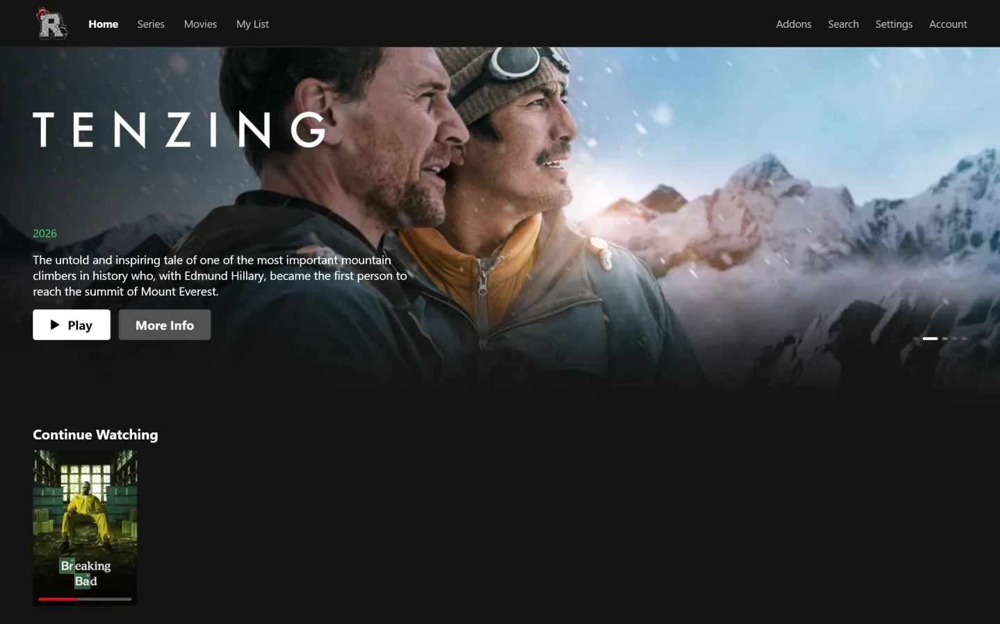
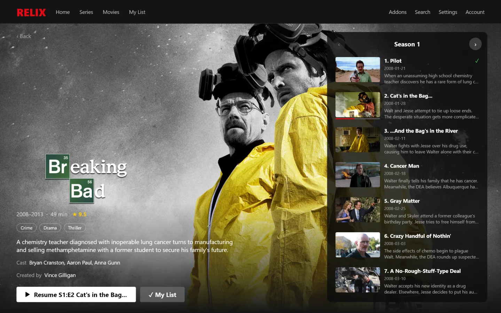
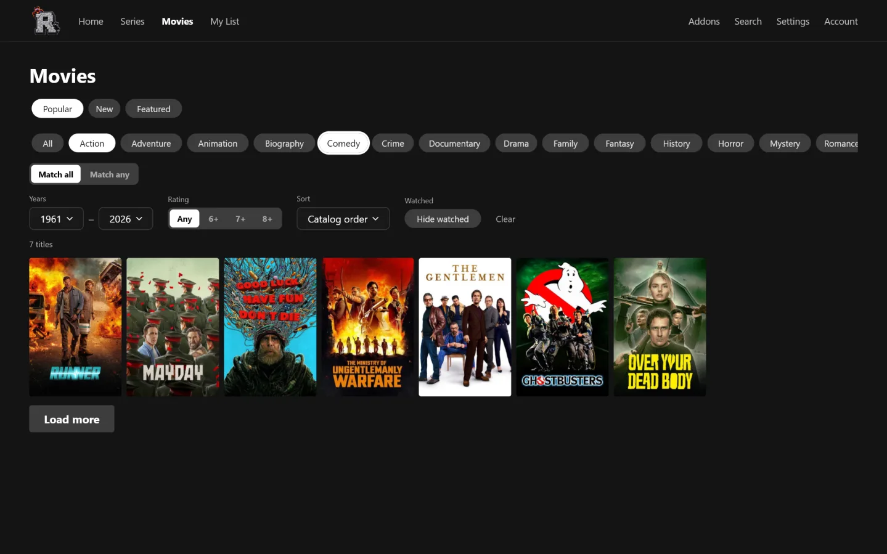

<p align="center">
  
</p>

<h1 align="center">Relix</h1>

<p align="center">
  A Netflix-style desktop app for Stremio addons. Native, GPU-fast playback, synced across your devices.<br>
  <a href="https://relix.carbonkit.tech">relix.carbonkit.tech</a> ·
  <a href="https://github.com/AyushChauhan9389/relix/releases/latest">Download</a>
</p>

<p align="center">
  
</p>

## Features

- **Every Stremio addon** works: catalogs, metadata, streams and subtitles. Import your addons from a Stremio account.
- **Two looks:** Netflix (featured title, rows) or Stremio (sidebar, search bar), switchable in Settings.
- **Title pages** with seasons, episodes, cast and streams grouped by addon.
- **Filters:** several genres (match all or any), year range, rating, sort, hide watched.
- **Player** inside the app window (mpv, GPU decoding, HDR), subtitles from addons, next-episode auto-play.
- **Fullscreen mode** for the whole app (button, F11, Esc to leave).
- **Account sync** of addons, My List, progress and settings at relix.carbonkit.tech.
- **Signed auto-update** for the portable builds and the Windows setup.

<p align="center">
  
  
</p>

## Download

From the [latest release](https://github.com/AyushChauhan9389/relix/releases/latest):

| | File | |
|---|---|---|
| **Windows** | `Relix-<version>-windows-x64-setup.exe` | Installer, no admin needed. Updates itself. |
| | `Relix-<version>-windows-x64.msi` | Installer for managed PCs (all users). Updates through its installer (asks for admin once). |
| | `Relix-<version>-windows-x64-portable.exe` | One file, no install, data next to it. Updates itself. |
| | `Relix-<version>-windows-x64-portable.zip` | The same as a folder. Updates itself. |
| **Linux** | `Relix-<version>-linux-amd64.deb` | Debian/Ubuntu package. |
| | `Relix-<version>-linux-x64.tar.gz` | Portable; needs your distribution's libmpv. Updates itself. |

## Develop

Needs Rust and libmpv.

- **Linux:** install libmpv (`libmpv-dev` / `mpv-libs` / `mpv`).
- **Windows:** run `packaging/ci/windows-mpv.ps1` from the repo root (needs Visual Studio's C++ tools). It puts
  libmpv and its import library in `vendor/mpv`; the build copies `libmpv-2.dll` next to the exe.

```sh
cargo test                                  # all tests
cargo run -p relix-app                      # the app
cargo run -p relix-app -- --play <url>      # play one URL without the UI
```

`RELIX_TEST_OFFSCREEN=1` runs the app off-screen and muted, for automated checks. Design notes live in
[PLAN.md](PLAN.md), [GLOSSARY.md](GLOSSARY.md) and [docs/adr](docs/adr).

## Releases

Builds happen only in GitHub Actions. **CI** lints and tests on Windows and Linux on every push. **Release** runs by
hand (Actions → Release → Run workflow) after bumping `version` in `crates/relix-app/Cargo.toml`:

1. Refuses a version that's already tagged or not newer than the one the server publishes.
2. Builds every file in the table above (installers with [cargo-packager](https://github.com/crabnebula-dev/cargo-packager)).
3. Signs the portable builds with the `RELIX_UPDATE_SIGNING_KEY` secret, creates the GitHub release, and uploads them
   to the server with `RELIX_ADMIN_TOKEN`. Running copies offer "Restart" on their next launch.

The public half of the signing key is `packaging/update-key.pub`; `relix-server update keygen <file>` makes a new
pair. Whoever has the private key can ship code to every install.

## Sync server

`relix-server` is one binary with one SQLite file; the app works fully without an account. Production runs at
relix.carbonkit.tech; see [packaging/server](packaging/server/README.md) for deploying and publishing.

```sh
cargo run -p relix-server        # listens on 0.0.0.0:8787, prints verification codes to stdout
```

Configured with `RELIX_DB`, `RELIX_ADDR`, `RELIX_SMTP_URL` + `RELIX_SMTP_FROM` (emailed codes),
`RELIX_VERIFY_EMAIL`, `RELIX_ADMIN_TOKEN` and `RELIX_UPDATE_DIR`. Like Stremio, it stores each account's addons,
library, progress and settings readable (debrid keys included), so run it behind HTTPS. The app's server address is
fixed when building (`RELIX_SERVER`, defaulting to `http://localhost:8787` outside the Release workflow).

Admin addons, published to every signed-in account (users can switch them off):

```sh
relix-server admin add https://anime-kitsu.strem.fun/manifest.json   # RELIX_ADMIN_TOKEN, RELIX_SERVER_URL
relix-server admin list
relix-server admin remove 1
```

## License

The app is GPL-3.0, the server AGPL-3.0. Relix is not affiliated with Netflix or Stremio.
